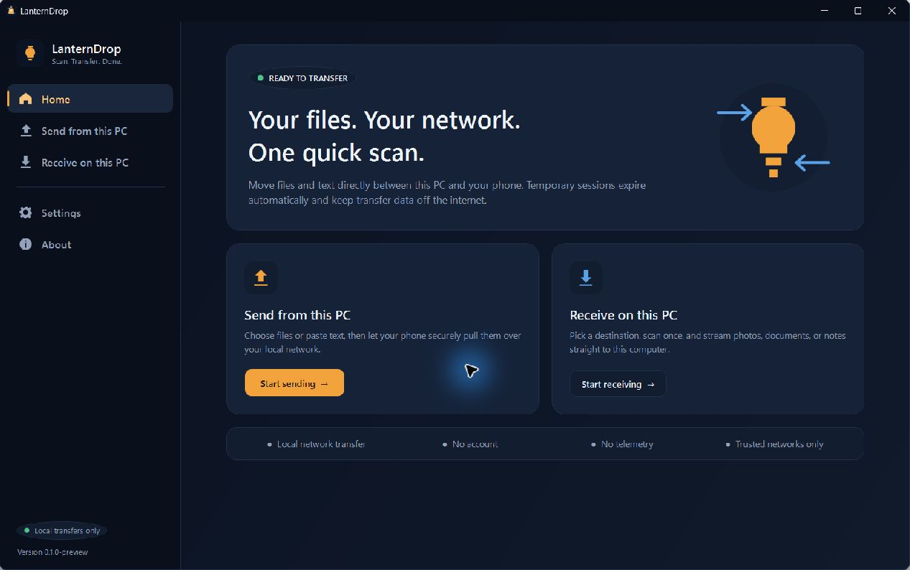
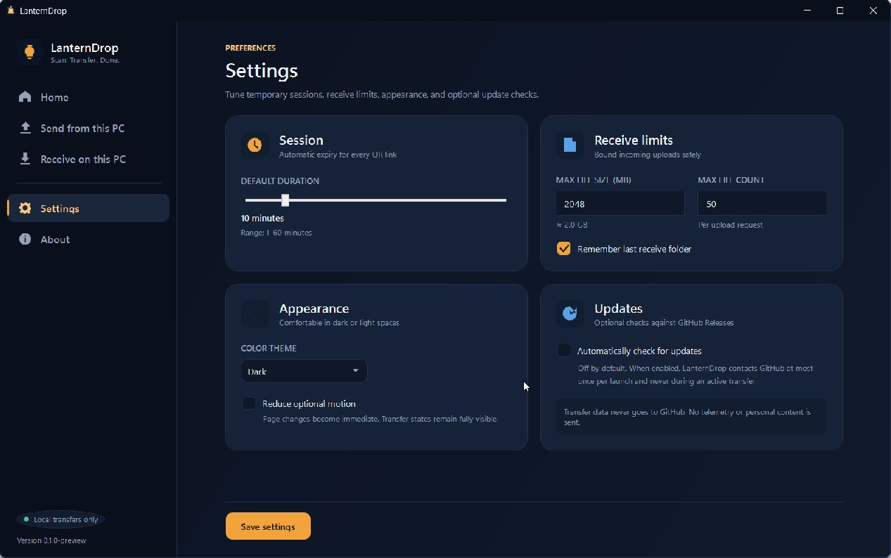
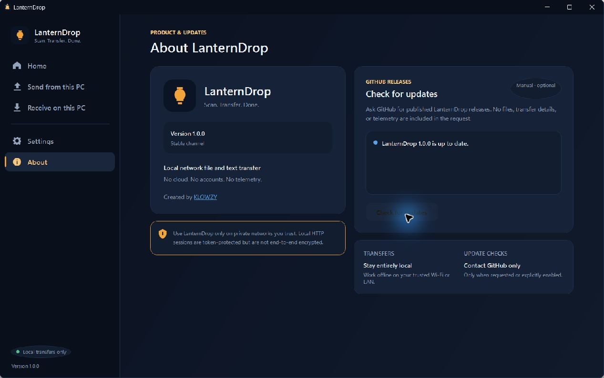
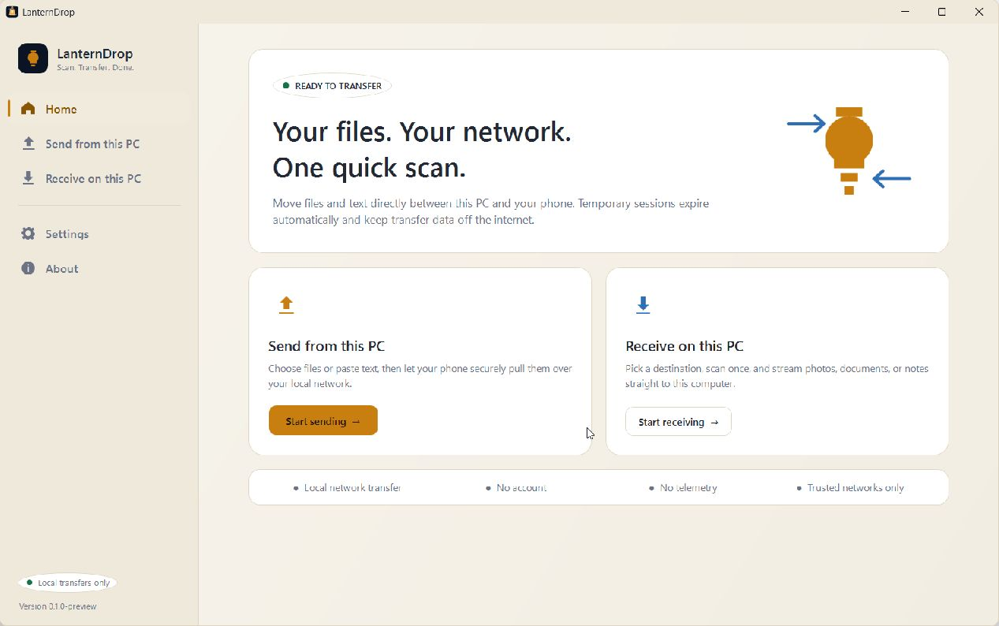
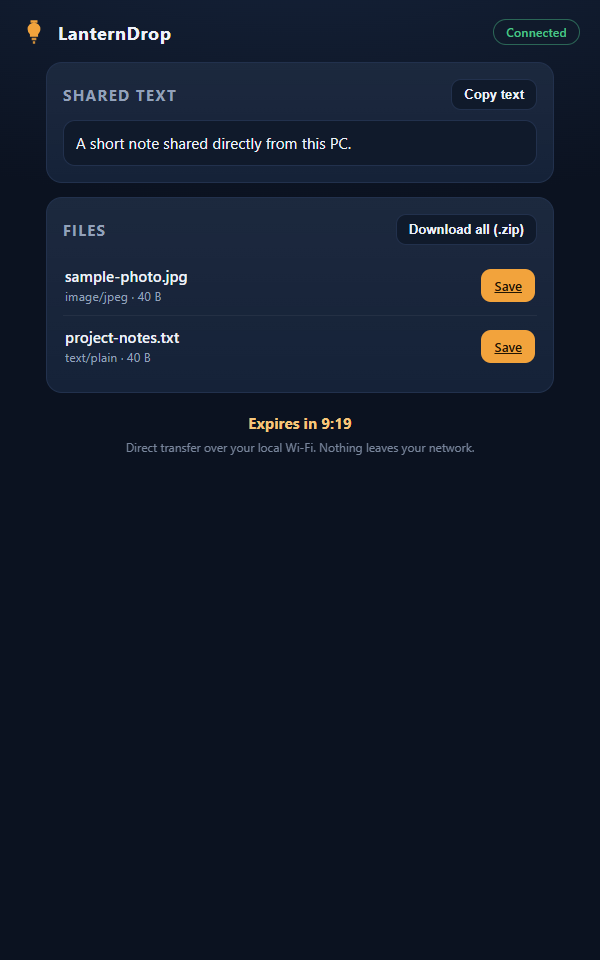
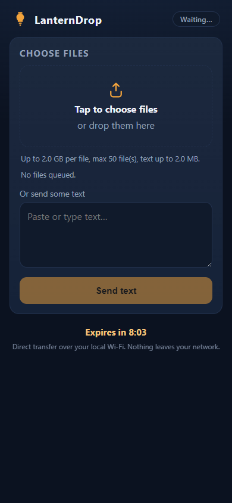

# LanternDrop

  

<strong>Scan. Transfer. Done.</strong>

LanternDrop is a Windows 11 application for exchanging files and plain text with a phone on the same private local network. Scan one temporary QR code and transfer directly between the two devices—no phone application, browser extension, account, cloud storage, or telemetry required.

> **Stable release:** LanternDrop 1.0.0 is the first general release of LanternDrop.

## Download

[**Download LanternDrop 1.0.0**](https://github.com/KlowzyZ/LanternDrop/releases/latest)

| Asset | Use |
|---|---|
| [LanternDrop.exe](https://github.com/KlowzyZ/LanternDrop/releases/latest/download/LanternDrop.exe) | Standalone Windows x64 application |
| [LanternDrop-1.0.0-win-x64.zip](https://github.com/KlowzyZ/LanternDrop/releases/latest/download/LanternDrop-1.0.0-win-x64.zip) | ZIP containing the standalone application |
| [SHA256SUMS.txt](https://github.com/KlowzyZ/LanternDrop/releases/latest/download/SHA256SUMS.txt) | Published SHA-256 checksums |

The executable is not currently code-signed, so Windows may display a Microsoft Defender SmartScreen warning. Windows Firewall may also ask whether LanternDrop can communicate on **Private networks** when a local session starts.

## Features

- Send files and text from Windows to a phone.
- Receive files and text from a phone.
- Temporary, expiring QR-code sessions.
- Direct streaming on the selected LAN, including HTTP Range downloads.
- Collision-safe receives, upload cancellation, and partial-file cleanup.
- Per-transfer progress, bytes, speed, and activity history.
- Dark and Light themes plus Reduce Motion.
- Manual update checks and optional once-per-launch checks through GitHub Releases.
- No cloud relay, account, phone installation, analytics, or telemetry.

## Three steps

1. Open **Send from this PC** or **Receive on this PC**, choose the content or destination, and select the private-network adapter shared with your phone.
2. Start the temporary session and scan the QR code with the phone.
3. Transfer in the phone browser, then stop the session or let it expire automatically.

The primary target is **Windows 11 x64**. The phone needs a modern browser and must be able to reach the PC on the same trusted Wi-Fi, Ethernet LAN, or personal hotspot.

## Screenshots

### Windows

Light theme

### Phone browser

| Receive from the PC | Send to the PC |
|---|---|
|  |  |

## Privacy and update checks

File and text transfers remain on the selected LAN. They are not uploaded to GitHub or another cloud service. LanternDrop collects no analytics or telemetry.

Update checks contact GitHub only when manually requested or when **Automatically check for updates** is enabled. They send ordinary network metadata, but no transfer content, filenames, local paths, clipboard text, session tokens, telemetry, or analytics. Local transfers continue to work without internet access. See [PRIVACY.md](PRIVACY.md).

## Trusted-network warning

LanternDrop transfer traffic uses local HTTP and is **not encrypted or end-to-end encrypted**. The temporary random token reduces casual unauthorized access, but it cannot protect traffic from a capable local-network interceptor. Use LanternDrop only on a trusted private network or personal hotspot. Public or shared Wi-Fi is not recommended.

LanternDrop has not received an external security audit. See [SECURITY.md](SECURITY.md) for responsible reporting guidance.

## Known limitations

- Windows 11 x64 is the primary target.
- A trusted private LAN is required; IPv4 is used for sessions.
- Local HTTP is not encrypted.
- The unsigned executable may trigger SmartScreen.
- Windows Firewall policy can require a user decision for Private-network access.
- Automatic download or installation of updates is not included.
- LanternDrop has not received an external security audit.
- Formal licensing terms are not finalized.

## Developer and copyright

Developed by [**KLOWZY**](https://github.com/KlowzyZ).

Copyright © 2026 KLOWZY. All rights reserved.

LanternDrop 1.0.0 is provided free for personal use and evaluation. Formal licensing terms for redistribution or commercial use may be introduced in a future release.
